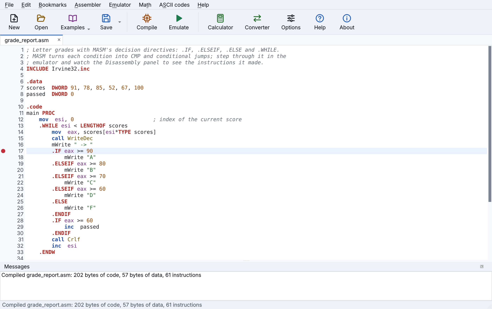
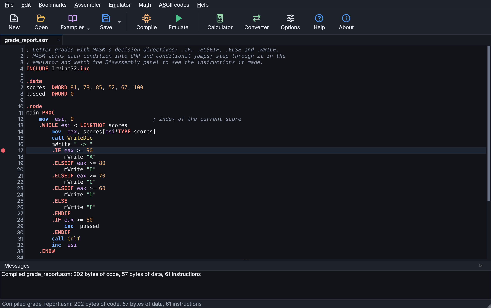
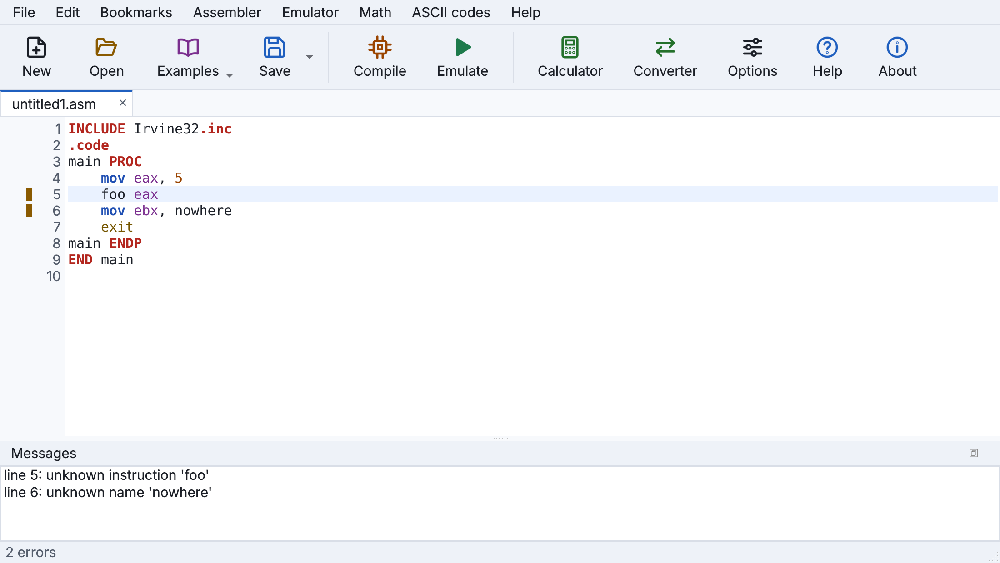
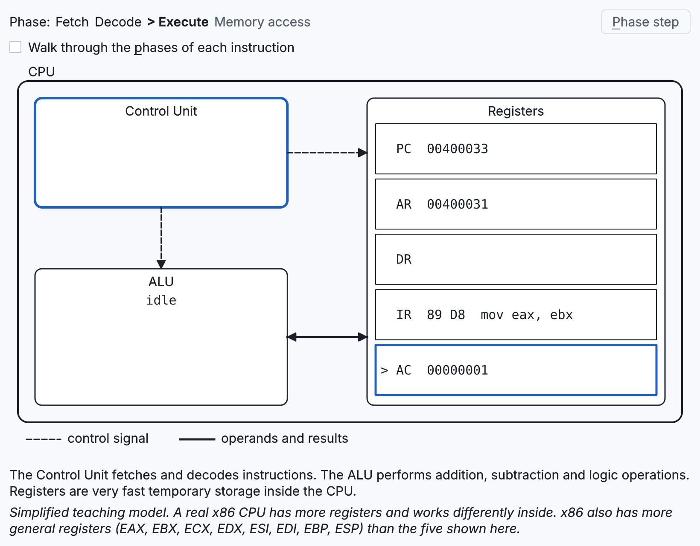
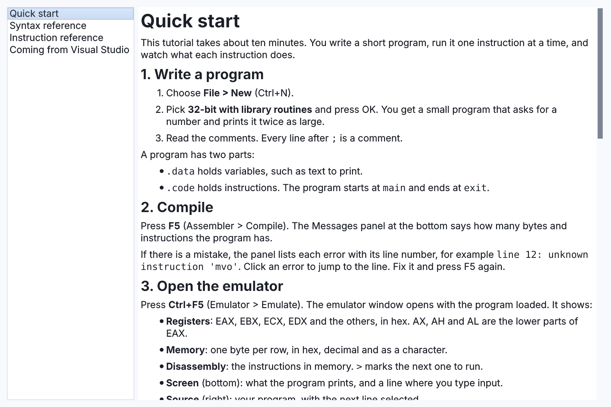
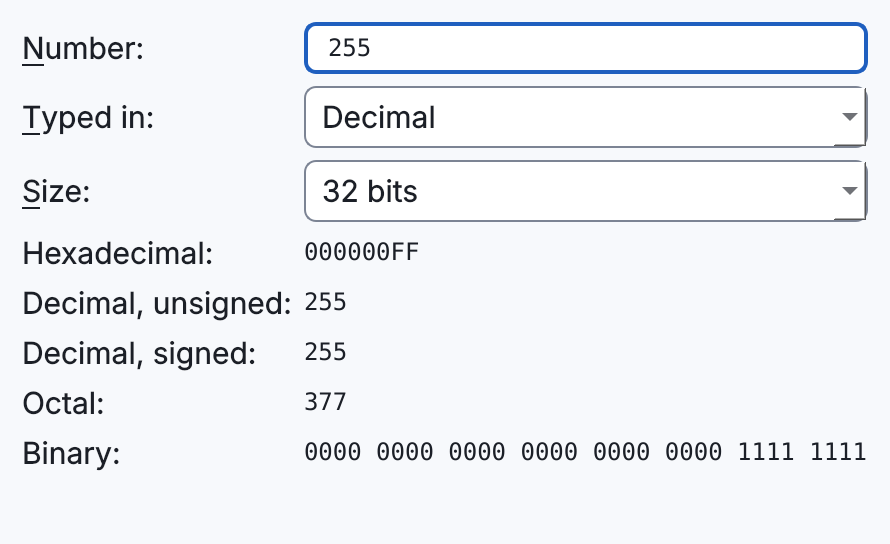
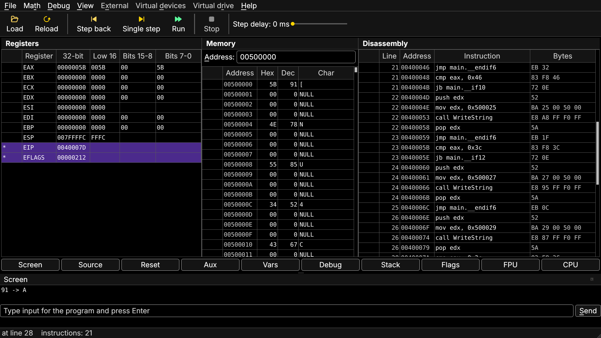

<h1 align="center">emu32</h1>

<p align="center"><b>Learn 32-bit x86 assembly by watching it run.</b></p>

<p align="center">
<a href="https://github.com/hani-k07/emu32/actions/workflows/ci.yml"></a>
<a href="https://github.com/hani-k07/emu32/releases/latest"></a>
<a href="LICENSE"></a>


</p>

<p align="center">
<a href="https://github.com/hani-k07/emu32/releases/latest"><b>Download for Windows</b></a> |
<a href="#quick-start">Quick start</a> |
<a href="docs/classroom.md">For instructors</a>
</p>

<p align="center"></p>

emu32 is a desktop tool for learning 32-bit x86 (IA-32) assembly. Write a program in the
editor, compile it, then run it one instruction at a time and watch the registers, flags,
memory, stack, variables and screen output change. Made a mistake? Step back.

It runs the MASM programs written for Visual Studio courses with the Irvine32 library
unchanged, so a course can use emu32 instead of setting up Visual Studio: no project
settings, no linker, and a debugger that shows every register, flag and memory byte as you
step.

**[Download emu32 for Windows](https://github.com/hani-k07/emu32/releases/latest)**: open the
latest release and download the file named `emu32-<version>-windows.zip`. The green **Code >
Download ZIP** button gives the source code, not the program.

## Contents

[Screenshots](#screenshots) |
[Why emu32](#why-emu32) |
[Features](#features) |
[Install](#install) |
[Quick start](#quick-start) |
[Limitations](#known-limitations) |
[For instructors](#for-instructors) |
[Contributing](#contributing) |
[License](#license)

## Screenshots

<table>
<tr>
<td width="50%"><br><sub><b>Editor</b>, light theme (the default). Click the margin for a breakpoint.</sub></td>
<td width="50%"><br><sub><b>Dark theme</b>, a choice in Options.</sub></td>
</tr>
<tr>
<td width="50%"><br><sub><b>Errors</b> with line numbers. Click one to jump to the line.</sub></td>
<td width="50%"><br><sub><b>CPU view</b>: fetch, decode and execute on a simple model.</sub></td>
</tr>
<tr>
<td width="50%"><br><sub><b>Built-in help</b>: tutorial, syntax and instruction references, and a page for Visual Studio users.</sub></td>
<td width="50%"><br><sub><b>Converter</b>, plus a calculator and an ASCII table.</sub></td>
</tr>
</table>

### Reading the Registers panel

emu32 is 32-bit only. The Registers panel shows each register whole in the **32-bit**
column, then splits it into parts: **Low 16** is AX (the low half of EAX), **Bits 15-8** is
AH and **Bits 7-0** is AL. They are parts of the same register, not a 16-bit mode. Hover a
column title for a reminder. Registers that changed in the last step are marked with `*`.

## Why emu32

- **See everything.** Registers, flags, memory, stack, variables and the FPU are on screen
  while you step, and what just changed is marked.
- **Step back.** Undo single steps, including memory and FPU state.
- **Course programs just work.** `INCLUDE Irvine32.inc`, `INVOKE`, `.IF`/`.WHILE`, macros
  and structures are supported; see the lists below.
- **Nothing to configure.** Unzip and run. It works offline and sends no data.
- **Made for teaching.** Light, dark and projector modes, plus a CPU view that shows
  fetch, decode and execute.

## Features

**Visual Studio / Irvine32 programs**

- `INCLUDE Irvine32.inc`, `PROC`/`ENDP` with `USES` and `LOCAL`, `INVOKE` and `PROTO`
- `.IF`/`.ELSEIF`/`.ELSE`, `.WHILE`, `.REPEAT`/`.UNTIL`, `.BREAK`/`.CONTINUE`
- `MACRO` with `LOCAL` and default values; `mWrite`, `mWriteLn` and the other course
  macros built in
- `STRUCT`, `QWORD`, `LABEL`, `ALIGN`, `TEXTEQU`, `@@` labels, `LENGTHOF`/`SIZEOF`/`TYPE`
- Conditional assembly and repeat blocks: `IF`/`IFB`/`IFIDN`/`ELSE`, `REPT`, `FOR`,
  `FORC`, `WHILE`
- Floating point: `REAL4`/`REAL8`/`REAL10`, the x87 FPU instructions, `WriteFloat`,
  `ReadFloat`, `ShowFPUStack`
- The Irvine32 console routines (`WriteString`, `ReadInt`, `DumpRegs`, ...) and
  `int 21h` services; Intel/NASM style as well

**Debugger**

- Panels for registers, memory, disassembly, stack, variables, flags, FPU and screen
- Single step, step over, step back (registers, memory and FPU), run with a step delay,
  breakpoints and watches
- Each 32-bit register shown whole and split into its 16-bit and 8-bit parts, with changed
  values marked
- A CPU structure view that shows fetch, decode and execute in a simple model

**Editor and tools**

- Syntax coloring, error list with line numbers (click to jump), breakpoints, autosave
- Examples, converter, calculator and ASCII table; a quick start tutorial, references
  and a "Coming from Visual Studio" page
- Works offline; light, dark and projector modes for teaching

## Install

### Windows: download and run

1. Open the [latest release](https://github.com/hani-k07/emu32/releases/latest).
2. Download the file named **`emu32-<version>-windows.zip`**. (GitHub also lists "Source
   code" archives; those are not the program.)
3. Unzip it and run **`emu32-setup.exe`**. No administrator rights are needed.

The zip holds only `emu32-setup.exe` and `README.txt`. To run without installing (for
example from a USB stick), download **`emu32-<version>-portable.zip`** from the same page,
unzip it and run `emu32\emu32.exe`.

The program is not signed, so Windows may show "Windows protected your PC". Click
**More info**, then **Run anyway**. The SHA-256 checksums of both zips are in the release notes.

The Windows build works fully offline: emu32 makes no network connections, sends no usage
data and does not check for updates. Besides emu32's own open-source code it contains the
Python runtime, Qt and the engines (all open source), and Microsoft's Visual C++ runtime
DLLs, which Python and Qt need on Windows; those are redistributable but not open source.
See [THIRD_PARTY_NOTICES.md](THIRD_PARTY_NOTICES.md).

### With pip (Windows, Linux, macOS)

Python 3.11 or newer:

```
pip install git+https://github.com/hani-k07/emu32.git
emu32
```

`python -m emu32` also works. pip installs Unicorn, Keystone, Capstone and Qt for Python.

### From source

```
git clone https://github.com/hani-k07/emu32.git
cd emu32
pip install .
emu32
```

## A first program

Paste this into the editor, press F5 to compile and Ctrl+F5 to open the emulator, then
press F8 to step through it:

```asm
INCLUDE Irvine32.inc

.data
msg BYTE "Sum of 1..10 = ", 0

.code
main PROC
    mov  edx, OFFSET msg
    call WriteString
    mov  eax, 0
    mov  ecx, 10
L1: add  eax, ecx          ; watch EAX and ECX change after every step
    loop L1
    call WriteDec          ; prints 55
    call Crlf
    exit
main ENDP
END main
```

## Quick start

1. File > New, pick "32-bit with library routines", OK.
2. Press F5 to compile. Errors appear with their line numbers; click one to jump there.
3. Press Ctrl+F5 to open the emulator.
4. Press F8 to run one instruction; changed registers are marked with `*`.
5. Press F9 to run to the end, Esc to stop, Shift+F8 to step back.

The full tutorial is under Help > Quick start tutorial (F1), and in
[src/emu32/help/quickstart.md](src/emu32/help/quickstart.md). The
[syntax reference](src/emu32/help/syntax.md) and
[instruction reference](src/emu32/help/instructions.md) are in the same folder.

## Known limitations

- 32-bit only. A 16-bit mode is planned.
- Release downloads are for Windows. On Linux and macOS, install with pip.
- Flat memory without segments; one source file per program.
  [docs/differences.md](docs/differences.md) lists everything emu32 does differently.
- Step back covers the last 10,000 single steps; Run clears it. The trace window lists
  single steps only.
- Run stops after 100 million instructions by default (changeable in Options).

## For instructors

<p align="center"></p>

Projector mode (Ctrl+Shift+P in the emulator window) gives large text and high contrast.
Hide the Source pane with the **Source** button to give the tables more room.

[docs/classroom.md](docs/classroom.md) explains how to put emu32 on lab PCs, what is
supported, and how to check a release on a clean machine. Students coming from Visual
Studio can open Help > Coming from Visual Studio: it lists what carries over and how the
debugger panels match Visual Studio's windows. `tests/vs_programs` holds the course-style
programs that every build is tested with.

## Contributing

See [CONTRIBUTING.md](CONTRIBUTING.md). Bug reports and ideas are welcome in the
[issues](https://github.com/hani-k07/emu32/issues).

## License

emu32 is free software under the GNU General Public License, version 2 or later. See
[LICENSE](LICENSE) and [THIRD_PARTY_NOTICES.md](THIRD_PARTY_NOTICES.md) for the libraries
it uses.

emu32 is an independent project. It is not affiliated with, endorsed by, or derived from
EMU8086 or its authors.
