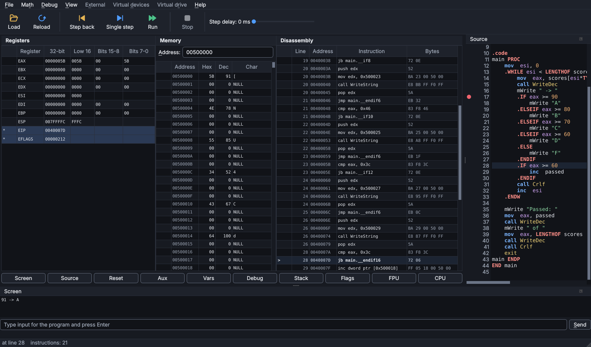
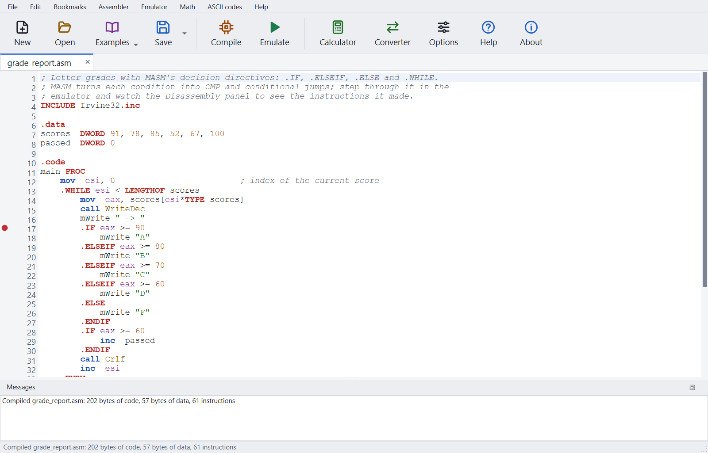

# emu32

A desktop tool for learning 32-bit x86 (IA-32) assembly. Write a program in the editor,
compile it, then run it one instruction at a time and watch the registers, flags, memory,
stack, variables and screen output change.

**[Download emu32 for Windows](https://github.com/hani-k07/emu32/releases/latest)**: open the
latest release and download the file named `emu32-<version>-windows.zip`. The green **Code >
Download ZIP** button gives the source code, not the program.



- Editor with syntax coloring, error list with line numbers, breakpoints and autosave
- Emulator window: registers, memory, disassembly, stack, variables, flags, screen
- Single step, step over, step back, run with a step delay, breakpoints and watches
- A CPU structure view that shows fetch, decode and execute in a simple model
- Runs the MASM programs written for Visual Studio and the Irvine32 library unchanged:
  `INVOKE`, `.IF`/`.WHILE`/`.REPEAT`, macros (with `mWrite`), `STRUCT`, `QWORD`, `LOCAL`
- Intel/NASM style as well
- Built-in console library (`WriteString`, `ReadInt`, ...) and `int 21h` services
- Converter, calculator and ASCII table; a quick start tutorial and references
- Works offline; projector mode for teaching

## Install

### Windows: download and run

1. Open the [latest release](https://github.com/hani-k07/emu32/releases/latest).
2. Download the file named **`emu32-<version>-windows.zip`**. (GitHub also lists "Source
   code" archives; those are not the program.)
3. Unzip it and run **`emu32-setup.exe`**. No administrator rights are needed.

The zip holds only `emu32-setup.exe` and `README.txt`. To run without installing (for
example from a USB stick), download **`emu32-<version>-portable.zip`** from the same page,
unzip it and run `emu32\emu32.exe`.

The program is not signed, so Windows may show "Windows protected your PC". Click
**More info**, then **Run anyway**. The SHA-256 checksums of both zips are in the release notes.

The Windows build works fully offline: emu32 makes no network connections, sends no usage
data and does not check for updates. Besides emu32's own open-source code it contains the
Python runtime, Qt and the engines (all open source), and Microsoft's Visual C++ runtime
DLLs, which Python and Qt need on Windows; those are redistributable but not open source.
See [THIRD_PARTY_NOTICES.md](THIRD_PARTY_NOTICES.md).

### With pip (Windows, Linux, macOS)

Python 3.11 or newer:

```
pip install git+https://github.com/hani-k07/emu32.git
emu32
```

`python -m emu32` also works. pip installs Unicorn, Keystone, Capstone and Qt for Python.

### From source

```
git clone https://github.com/hani-k07/emu32.git
cd emu32
pip install .
emu32
```

## Quick start

1. File > New, pick "32-bit with library routines", OK.
2. Press F5 to compile. Errors appear with their line numbers; click one to jump there.
3. Press Ctrl+F5 to open the emulator.
4. Press F8 to run one instruction; changed registers are marked with `*`.
5. Press F9 to run to the end, Esc to stop, Shift+F8 to step back.

The full tutorial is under Help > Quick start tutorial (F1), and in
[src/emu32/help/quickstart.md](src/emu32/help/quickstart.md). The
[syntax reference](src/emu32/help/syntax.md) and
[instruction reference](src/emu32/help/instructions.md) are in the same folder.



## Known limitations

- 32-bit only. A 16-bit mode is planned.
- Release downloads are for Windows. On Linux and macOS, install with pip.
- Flat memory without segments; one source file per program; no floating-point data and
  no conditional assembly (`IF`, `REPT`).
  [docs/differences.md](docs/differences.md) lists everything emu32 does differently.
- Step back covers the last 10,000 single steps; Run clears it. The trace window lists
  single steps only.
- Run stops after 100 million instructions by default (changeable in Options).

## For instructors

[docs/classroom.md](docs/classroom.md) explains how to put emu32 on lab PCs, what is
supported, and how to check a release on a clean machine. Students coming from Visual
Studio can open Help > Coming from Visual Studio: it lists what carries over and how the
debugger panels match Visual Studio's windows. `tests/vs_programs` holds the course-style
programs that every build is tested with.

## Contributing

See [CONTRIBUTING.md](CONTRIBUTING.md). Bug reports and ideas are welcome in the
[issues](https://github.com/hani-k07/emu32/issues).

## License

emu32 is free software under the GNU General Public License, version 2 or later. See
[LICENSE](LICENSE) and [THIRD_PARTY_NOTICES.md](THIRD_PARTY_NOTICES.md) for the libraries
it uses.

emu32 is an independent project. It is not affiliated with, endorsed by, or derived from
EMU8086 or its authors.
